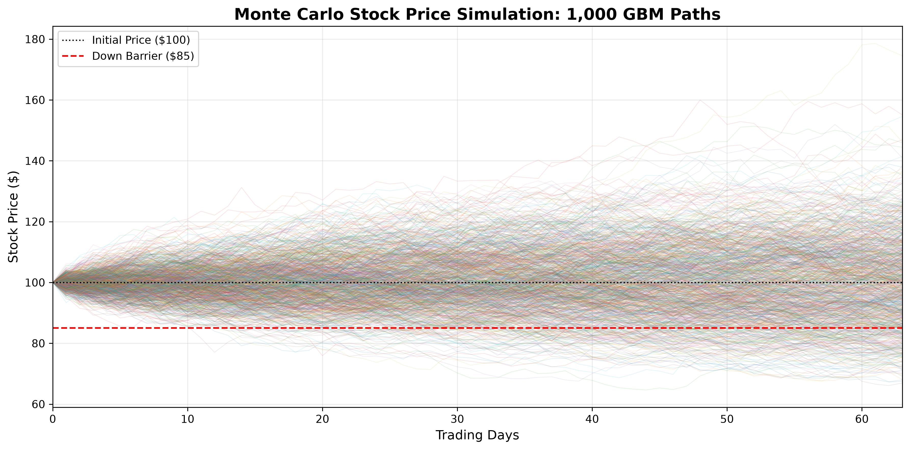
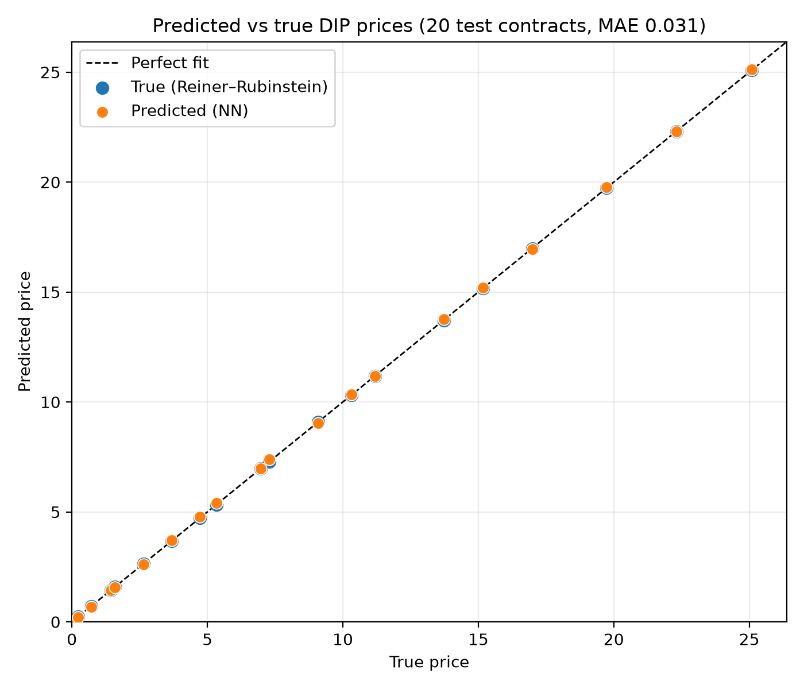
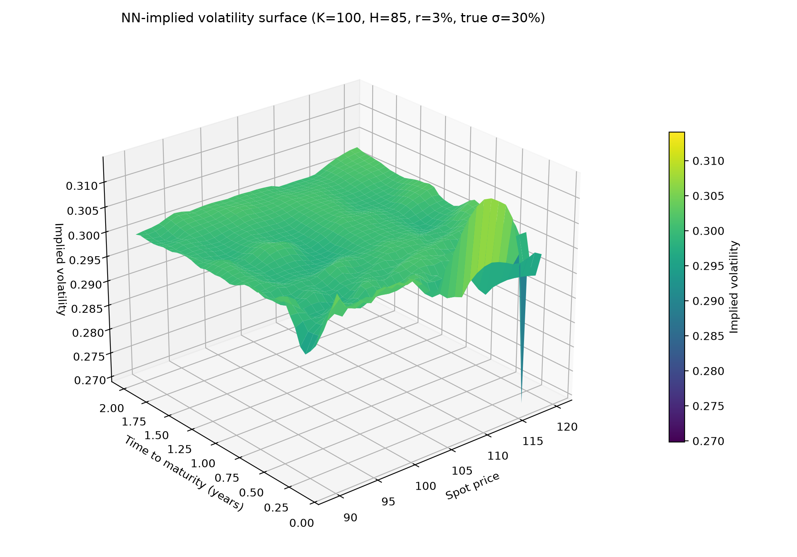

# Down-and-In Put Pricing and Dynamic Hedging

A research-oriented Python project for pricing and dynamically hedging a down-and-in European put (DIP). The repository combines a closed-form barrier-option benchmark, Monte Carlo simulation, neural-network pricing, and reinforcement-learning hedging in one reproducible workflow.

## What this repository does

- Simulates underlying-price paths with Geometric Brownian Motion (GBM).
- Prices a down-and-in put with a closed-form Black--Scholes / Reiner--Rubinstein benchmark.
- Estimates prices with standard Monte Carlo and antithetic variates.
- Trains an MLP pricing surrogate on synthetically generated contracts.
- Compares analytical-Delta, Monte-Carlo-Delta, and PPO-based dynamic hedging.
- Evaluates hedging error, tail risk, turnover, and transaction costs under different market scenarios.

## Down-and-in put

The option has strike `K`, lower barrier `H < K`, and maturity `T`. It becomes active only when the underlying price reaches or falls below `H` at least once before maturity. Its payoff is

`max(K - S_T, 0) × 1{min(S_t) ≤ H}`

The simulation model assumes that the underlying follows GBM:

`dS_t = μ S_t dt + σ S_t dW_t`

Pricing uses risk-neutral drift `r`; hedging experiments can instead use the real-world drift `μ`.

## GBM simulation

The currently implemented simulator generates exact discrete GBM paths and saves the visualisation below. The dashed red line is the down barrier; a path crossing it activates the option.



Run the simulation and regenerate the figure with:

```bash
python -m stock_simulation.visualize
```

## Methodology

### Pricing

| Method | Purpose |
| --- | --- |
| Closed-form Black--Scholes / Reiner--Rubinstein | Analytical pricing benchmark for the barrier option. |
| Standard Monte Carlo | Estimates the discounted expected payoff from simulated paths. |
| Antithetic variates | Reduces Monte Carlo estimator variance by pairing shocks `Z` and `-Z`. |
| MLP regressor | Approximates prices from six standardised contract and market features. |

The Monte Carlo pricers monitor the barrier daily (63 dates). The closed form assumes continuous monitoring and is used without a continuity correction.

The MLP (`6 → 128 → 128 → 64 → 1`, ReLU, linear output) is trained with Adam, MSE loss, and early stopping. Its training data are 140,000 Latin-hypercube contracts labelled with the closed form and split 100k / 20k / 20k. Its inputs are spot, strike, barrier-to-spot ratio, maturity, volatility, and rate, standardised with train-set statistics. The target is the raw price.

### Dynamic hedging

All hedgers share the same simulated paths and self-financing cash-account convention.

1. **Analytical Delta:** finite-difference Delta for the barrier option before activation, then Black--Scholes put Delta after activation.
2. **Monte Carlo Delta:** finite-difference Delta with Common Random Numbers for a lower-variance bump-and-revalue estimate.
3. **PPO hedger:** a reinforcement-learning policy that adjusts the analytical Delta while accounting for its previous position and transaction costs.

## Baseline experiment

The default pricing configuration is in [`configs/pricing.yaml`](configs/pricing.yaml).

| Parameter | Value |
| --- | ---: |
| Initial spot / strike / barrier | 100 / 100 / 85 |
| Maturity | 0.25 years (3 months) |
| Monitoring dates | 63 daily observations |
| Volatility / risk-free rate | 30% / 3% |
| Real-world drift | 3% |
| Transaction-cost scenarios | 0, 0.1%, 0.5%, 1% |

## Pricing results

### Method comparison on the baseline contract

Both Monte Carlo estimators use 100,000 paths: 50,000 antithetic pairs in the antithetic case. Bias is measured against the continuous-monitoring Reiner--Rubinstein (RR) price.

| Method | Price | Bias vs reference | SE / CI 95% | Estimator variance | VRR | Runtime per pricing |
| --- | --- | --- | --- | --- | --- | --- |
| Reiner-Rubinstein (closed form) | 4.2622 | — (benchmark) | — | 0 | — | 2.8 µs |
| Standard Monte Carlo | 3.9854 | -0.2768 (vs RR) | 0.0249 / [3.9366, 4.0342] | 6.198e-04 | 1.00 | 3.07 s |
| Monte Carlo antithetic variates | 3.9852 | -0.2770 (vs RR) | 0.0214 / [3.9432, 4.0272] | 4.600e-04 | 1.35 | 2.33 s |
| Neural network (MLP) | 4.2991 | +0.0370 (vs RR) | — | — | — | 24.5 µs (0.17 µs/contract batched) |

- **Monitoring gap.** Both Monte Carlo prices sit about 0.28 (6.5%) below the closed form. This difference is not simulation error. Daily monitoring misses intraday barrier crossings, so fewer paths knock in than under continuous monitoring.
- **Antithetic variates.** At equal path budget, antithetic sampling cuts estimator variance by a factor of 1.35. The implied pair correlation is −0.26, and the standard error falls by about 16%. Including runtime, efficiency improves about 1.8×. The gain is modest because most paths never hit the barrier and pay zero.
- **Neural network.** The MLP is within 0.04 (0.9%) of the closed form. For a single contract it is slower than the closed form because of framework overhead. In batch it prices about 0.17 µs per contract, roughly 10⁵× faster than Monte Carlo.

VRR is the variance-reduction ratio: standard-MC estimator variance divided by antithetic estimator variance at the same number of paths.

### Neural-network accuracy

These errors are measured against closed-form labels on the raw price scale.

| Split | MAE | RMSE | Max abs error | Mean relative error (price > 0.1) |
| --- | ---: | ---: | ---: | ---: |
| Train | 0.0308 | 0.0416 | 0.592 | 1.16% |
| Validation | 0.0323 | 0.0442 | 0.535 | 1.22% |
| Test | 0.0322 | 0.0445 | 0.692 | 1.18% |

About 3% of test predictions are slightly negative. All of them are contracts whose true price is close to zero, and the linear output layer is unbounded.



The implied-volatility surface below takes the MLP price at each (spot, maturity) point, with K = 100, H = 85, r = 3% and σ = 30%. It then inverts the closed form to recover σ. The labels come from a constant-volatility model, so a perfect network would give a flat surface at 0.30. The mean absolute deviation is 0.001. The spikes at high spot and short maturity occur where the price is nearly zero and almost insensitive to σ.



### Reproducing the pricing results

```bash
python -m data.generate_pricing_dataset   # 140k labelled contracts -> data/pricing_dataset.csv
python -m data.split_pricing_dataset      # train / validation / test CSVs
python -m pricing.neural_network          # train + evaluate the MLP
python -m pricing.nn_visualize            # predicted-vs-true and implied-vol figures
python -m pricing.compare_methods         # four-method comparison table
```

Outputs are written to `results/tables/`, `results/figures/`, and `results/checkpoints/`.

## Evaluation

Pricing methods are assessed with MAE, RMSE, relative error, confidence intervals, estimator variance, and runtime. Hedging strategies are compared using terminal P&L, P&L dispersion, quantiles, 5% CVaR, transaction costs, turnover, and hedging effectiveness.

## Project layout

```text
configs/             # Pricing, hedging, and PPO experiment settings
pricing/             # Analytical, Monte Carlo, and neural-network pricing modules,
                     # NN figures (nn_visualize.py) and method comparison (compare_methods.py)
stock_simulation/    # GBM path generator and plotting utility
data/                # Dataset generation / split scripts and generated CSVs
results/figures/     # Generated charts (GBM paths, NN learning curves and predictions)
results/tables/      # Pricing comparison and NN metrics
results/checkpoints/ # Trained MLP checkpoint
plan.md              # Implementation roadmap
```

## Installation

Python 3.10 or newer is required.

```bash
python -m venv .venv
source .venv/bin/activate       # Windows PowerShell: .venv\Scripts\Activate.ps1
python -m pip install --upgrade pip
pip install -r requirements.txt
```

See [plan.md](plan.md) for the implementation roadmap and validation criteria.
