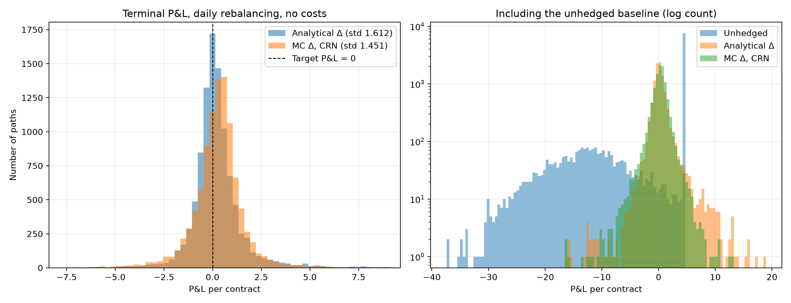
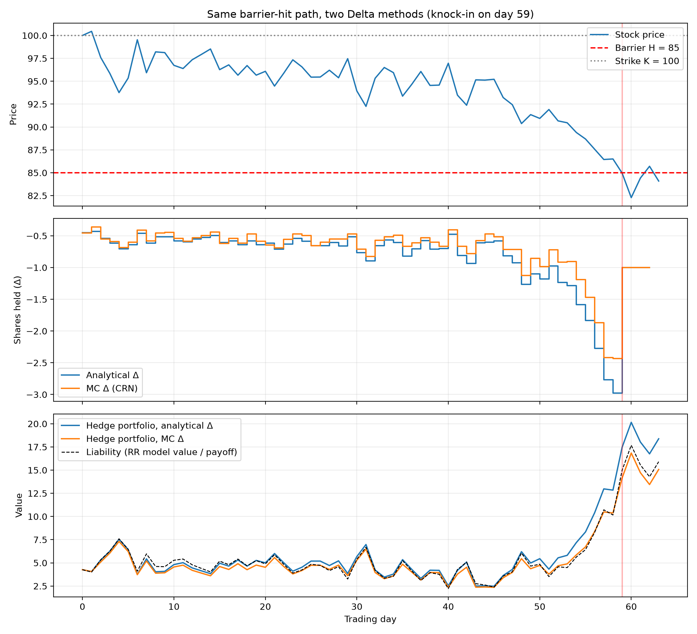

# Down-and-In Put Pricing and Dynamic Hedging

A research-oriented Python project for pricing and dynamically hedging a down-and-in European put (DIP). The repository combines a closed-form barrier-option benchmark, Monte Carlo simulation, neural-network pricing, and reinforcement-learning hedging in one reproducible workflow.

## What this repository does

- Simulates underlying-price paths with Geometric Brownian Motion (GBM).
- Prices a down-and-in put with a closed-form Black--Scholes / Reiner--Rubinstein benchmark.
- Estimates prices with standard Monte Carlo and antithetic variates.
- Trains an MLP pricing surrogate on synthetically generated contracts.
- Compares analytical-Delta, Monte-Carlo-Delta, and PPO-based dynamic hedging.
- Evaluates hedging error, tail risk, turnover, and transaction costs under different market scenarios.

## Down-and-in put

The option has strike `K`, lower barrier `H < K`, and maturity `T`. It becomes active only when the underlying price reaches or falls below `H` at least once before maturity. Its payoff is

`max(K - S_T, 0) × 1{min(S_t) ≤ H}`

The simulation model assumes that the underlying follows GBM:

`dS_t = μ S_t dt + σ S_t dW_t`

Pricing uses risk-neutral drift `r`; hedging experiments can instead use the real-world drift `μ`.

## GBM simulation

The currently implemented simulator generates exact discrete GBM paths and saves the visualisation below. The dashed red line is the down barrier; a path crossing it activates the option.


Run the simulation and regenerate the figure with:

```bash
python -m stock_simulation.visualize
```

## Methodology

### Pricing

| Method | Purpose |
| --- | --- |
| Closed-form Black--Scholes / Reiner--Rubinstein | Analytical pricing benchmark for the barrier option. |
| Standard Monte Carlo | Estimates the discounted expected payoff from simulated paths. |
| Antithetic variates | Reduces Monte Carlo estimator variance by pairing shocks `Z` and `-Z`. |
| MLP regressor | Approximates prices from six standardised contract and market features. |

The Monte Carlo pricers monitor the barrier daily (63 dates). The closed form assumes continuous monitoring and is used without a continuity correction.

The MLP (`6 → 128 → 128 → 64 → 1`, ReLU, linear output) is trained with Adam, MSE loss, and early stopping. Its training data are 140,000 Latin-hypercube contracts labelled with the closed form and split 100k / 20k / 20k. Its inputs are spot, strike, barrier-to-spot ratio, maturity, volatility, and rate, standardised with train-set statistics. The target is the raw price.

### Dynamic hedging

The hedger sells one DIP, receives the premium, and holds Δ shares of the stock. Δ < 0, so the hedge is a short stock position. All hedgers share the same simulated real-world paths, the same premium, and the same self-financing accounting:

```text
Cash_0 = premium − Δ_0·S_0 − cost_0
Cash_t = Cash_{t−1}·e^{rΔt} − (Δ_t − Δ_{t−1})·S_t − cost_t
P&L_T  = Cash_T + Δ_T·S_T − cost_T − payoff
```

`cost = transaction cost × |shares traded| × S`. The target is P&L = 0 on every path.

1. **Analytical Delta:** a central finite difference of the closed-form DIP price before knock-in, then the Black--Scholes put Delta `N(d1) − 1` after knock-in.
2. **Monte Carlo Delta (CRN):** a forward difference `[V(S+h) − V(S)]/h` with h = 1%·S. V is a Monte Carlo price with daily barrier monitoring over the remaining dates. Each date draws 5,000 fresh inner paths, and V(S) and V(S+h) reuse them (common random numbers). Because GBM is multiplicative, the inner paths are simulated once per date as growth factors and shared by all hedge paths.
3. **PPO hedger:** a reinforcement-learning policy that adjusts the analytical Delta while accounting for its previous position and transaction costs.

## Baseline experiment

The default pricing configuration is in [`configs/pricing.yaml`](configs/pricing.yaml).

| Parameter | Value |
| --- | ---: |
| Initial spot / strike / barrier | 100 / 100 / 85 |
| Maturity | 0.25 years (3 months) |
| Monitoring dates | 63 daily observations |
| Volatility / risk-free rate | 30% / 3% |
| Real-world drift | 3% |
| Transaction-cost scenarios | 0, 0.1%, 0.5%, 1% |

## Pricing results

### Method comparison on the baseline contract

Both Monte Carlo estimators use 100,000 paths: 50,000 antithetic pairs in the antithetic case. Bias is measured against the continuous-monitoring Reiner--Rubinstein (RR) price.

| Method | Price | Bias vs reference | SE / CI 95% | Estimator variance | VRR | Runtime per pricing |
| --- | --- | --- | --- | --- | --- | --- |
| Reiner-Rubinstein (closed form) | 4.2622 | — (benchmark) | — | 0 | — | 2.8 µs |
| Standard Monte Carlo | 3.9854 | -0.2768 (vs RR) | 0.0249 / [3.9366, 4.0342] | 6.198e-04 | 1.00 | 3.07 s |
| Monte Carlo antithetic variates | 3.9852 | -0.2770 (vs RR) | 0.0214 / [3.9432, 4.0272] | 4.600e-04 | 1.35 | 2.33 s |
| Neural network (MLP) | 4.2991 | +0.0370 (vs RR) | — | — | — | 24.5 µs (0.17 µs/contract batched) |

- **Monitoring gap.** Both Monte Carlo prices sit about 0.28 (6.5%) below the closed form. This difference is not simulation error. Daily monitoring misses intraday barrier crossings, so fewer paths knock in than under continuous monitoring.
- **Antithetic variates.** At equal path budget, antithetic sampling cuts estimator variance by a factor of 1.35. The implied pair correlation is −0.26, and the standard error falls by about 16%. Including runtime, efficiency improves about 1.8×. The gain is modest because most paths never hit the barrier and pay zero.
- **Neural network.** The MLP is within 0.04 (0.9%) of the closed form. For a single contract it is slower than the closed form because of framework overhead. In batch it prices about 0.17 µs per contract, roughly 10⁵× faster than Monte Carlo.

VRR is the variance-reduction ratio: standard-MC estimator variance divided by antithetic estimator variance at the same number of paths.

### Neural-network accuracy

These errors are measured against closed-form labels on the raw price scale.

| Split | MAE | RMSE | Max abs error | Mean relative error (price > 0.1) |
| --- | ---: | ---: | ---: | ---: |
| Train | 0.0308 | 0.0416 | 0.592 | 1.16% |
| Validation | 0.0323 | 0.0442 | 0.535 | 1.22% |
| Test | 0.0322 | 0.0445 | 0.692 | 1.18% |

About 3% of test predictions are slightly negative. All of them are contracts whose true price is close to zero, and the linear output layer is unbounded.


The implied-volatility surface below takes the MLP price at each (spot, maturity) point, with K = 100, H = 85, r = 3% and σ = 30%. It then inverts the closed form to recover σ. The labels come from a constant-volatility model, so a perfect network would give a flat surface at 0.30. The mean absolute deviation is 0.001. The spikes at high spot and short maturity occur where the price is nearly zero and almost insensitive to σ.


### Reproducing the pricing results

```bash
python -m data.generate_pricing_dataset   # 140k labelled contracts -> data/pricing_dataset.csv
python -m data.split_pricing_dataset      # train / validation / test CSVs
python -m pricing.neural_network          # train + evaluate the MLP
python -m pricing.nn_visualize            # predicted-vs-true and implied-vol figures
python -m pricing.compare_methods         # four-method comparison table
```

Outputs are written to `results/tables/`, `results/figures/`, and `results/checkpoints/`.

## Hedging results

The setup has 10,000 real-world GBM paths (μ = 3%, σ = 30%), daily rebalancing over 63 dates, and a premium of 4.2622 (Reiner--Rubinstein). The barrier is hit on 25.2% of paths. Both strategies hedge the same paths. Turnover is the number of shares traded per path.

| Strategy | Transaction cost | Mean P&L | Std P&L | CVaR 5% | Turnover (shares) |
| --- | --- | --- | --- | --- | --- |
| Unhedged | 0.0% | +0.2106 | 8.0213 | -22.6111 | 0.000 |
| Analytical Δ | 0.0% | +0.2402 | 1.6124 | -2.8912 | 4.652 |
| Analytical Δ | 0.1% | -0.2045 | 1.5775 | -3.7159 | 4.652 |
| Analytical Δ | 0.5% | -1.9830 | 1.8896 | -7.5523 | 4.652 |
| Analytical Δ | 1.0% | -4.2061 | 2.8910 | -13.0314 | 4.652 |
| MC Δ (CRN) | 0.0% | +0.2534 | 1.4507 | -3.4765 | 4.585 |
| MC Δ (CRN) | 0.1% | -0.1858 | 1.5047 | -4.3395 | 4.585 |
| MC Δ (CRN) | 0.5% | -1.9424 | 2.0093 | -8.0281 | 4.585 |
| MC Δ (CRN) | 1.0% | -4.1383 | 2.9677 | -12.9543 | 4.585 |

- **Hedging works.** Both strategies remove about 96–97% of the unhedged P&L variance, and 5% CVaR improves from −22.6 to about −3.
- **The mean P&L is positive (+0.24 to +0.25) without costs.** The premium is the continuous-monitoring price, but the contract is monitored daily. The seller keeps this monitoring gap, so the mean is not a hedging gain.
- **Analytical vs MC Δ.** MC Δ is consistent with daily monitoring, so its Delta is less extreme near the barrier and std P&L is lower (1.45 vs 1.61). Its Monte Carlo noise (about ±0.025 per date) fattens the left tail, so CVaR is worse (−3.48 vs −2.89). With costs of 0.5% or more, MC std is higher. The two strategies have similar turnover, and MC Δ is about 5× slower (17.5 s vs 3.3 s for 10,000 paths). These differences come from a single inner-path seed.
- **Transaction costs.** Each 0.1% of cost lowers mean P&L by about 0.44, which matches cost × turnover × S.



On a barrier-hit path, Delta falls well below −1 as the price approaches the barrier near maturity. The analytical Delta reaches −3.0 and the MC Delta −2.4. After knock-in, Delta jumps back to the vanilla-put Delta, about −1, so both hedgers buy back stock in one large trade. On this path, terminal P&L is +2.47 (analytical) and −0.84 (MC), against −11.61 unhedged.



### Reproducing the hedging results

```bash
python -m hedging.run_analytical_hedge   # strategy 1 only
python -m hedging.run_mc_hedge           # strategy 2 + comparison with strategy 1
```

Settings are in [`configs/hedging.yaml`](configs/hedging.yaml).

## Evaluation

Pricing methods are assessed with MAE, RMSE, relative error, confidence intervals, estimator variance, and runtime. Hedging strategies are compared against the target P&L = 0 using mean P&L, std P&L, 5% CVaR (mean P&L of the worst 5% of paths), and turnover.

## Project layout

```text
configs/             # Pricing, hedging, and PPO experiment settings
pricing/             # Analytical, Monte Carlo, and neural-network pricing modules,
                     # NN figures (nn_visualize.py) and method comparison (compare_methods.py)
hedging/             # Self-financing accounting, analytical and MC Delta, experiment scripts
stock_simulation/    # GBM path generator and plotting utility
data/                # Dataset generation / split scripts and generated CSVs
results/figures/     # Generated charts (GBM paths, NN learning curves and predictions)
results/tables/      # Pricing comparison and NN metrics
results/checkpoints/ # Trained MLP checkpoint
plan.md              # Implementation roadmap
```

## Installation

Python 3.10 or newer is required.

```bash
python -m venv .venv
source .venv/bin/activate       # Windows PowerShell: .venv\Scripts\Activate.ps1
python -m pip install --upgrade pip
pip install -r requirements.txt
```

See [plan.md](plan.md) for the implementation roadmap and validation criteria.
